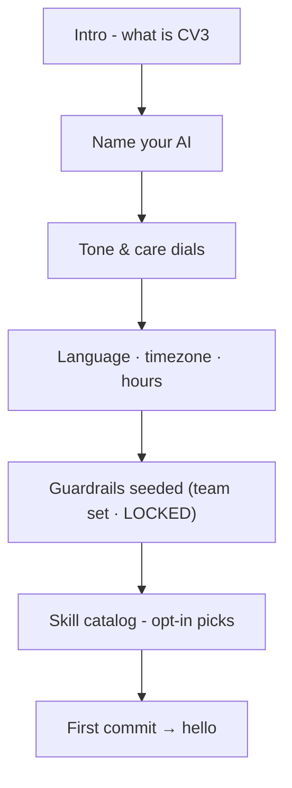
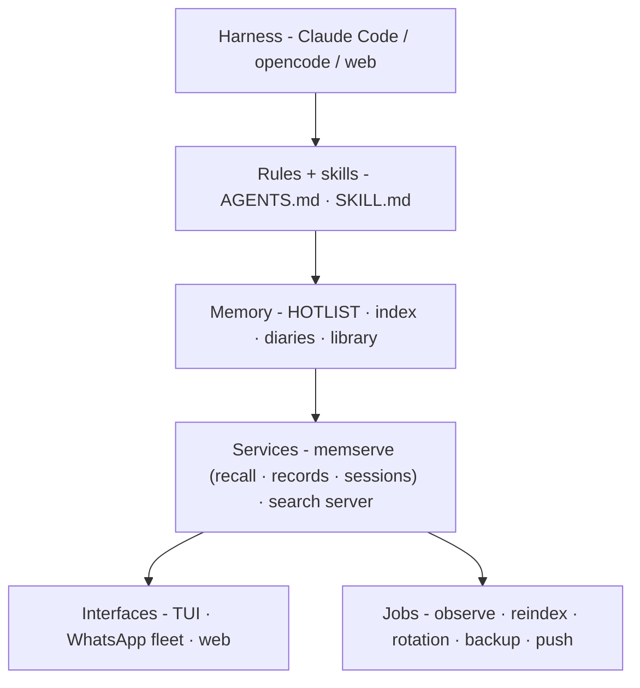
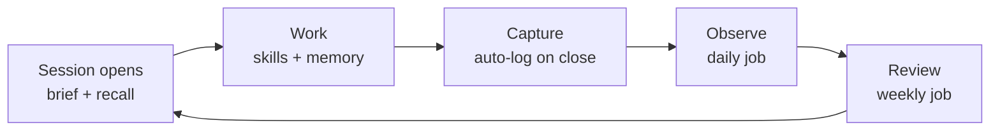
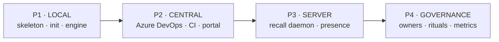

# CV3 Enterprise Edition - Design v1

> **Status: LOCKED** · 2026-10-16 · Wan + Shuhada
> Moved from CV3 `design/` (2026-10-17 housecleaning, spec `2026-10-17-cv4-team-edition`, P1). The deck brief lives with the deck (CV3-present repo).

## 0. TL;DR

**CV3 Enterprise Edition = CV3's engine, de-personalized for a team.**

Local-first for every developer. Guardrails they cannot overwrite (mechanically, not by promise).
Skills suggested, never forced. And a markdown knowledge base that centralizes safely  - 
**git is the database, PRs are the gate.**

De-personalized ≠ stripped: the engine stays whole (capture + memory + review + skill protocol);
identity, language, and workflow become *theirs*.

---

## 1. Context

- **The team**: a Japanese company, dozens of developers on one floor. Claude Code users.
  Markdown-first culture. "AI only where necessary." Azure for anything web-hosted.
- **What they have**: their own internal skills (planning, UI, audit…) and a strong working culture.
  They want CV3's engine **without** CV3's personal identity.
- **Their stated pain**: knowledge base across a whole floor - concurrency, sharing, and actual
  implementation. Their KB sources: past projects + Zoom recording transcripts.
- **Our gain**: a validated enterprise pattern, a public case study, and a hardened
  de-personalization story that improves CV3 itself.

---

## 2. Principles

1. **Local-first** - every dev runs the full engine standalone; zero infrastructure required to start.
2. **Guardrails locked** - never overwritten, enforced by mechanics. AI proposes; humans approve.
3. **Skills suggested, never forced** - a catalog with per-dev opt-in.
4. **Markdown-native** - git is the database; no DB in the core path.
5. **AI only where necessary** - deterministic jobs where possible; AI for distillation, review, drafting.

---

## 3. Trust Layers

```mermaid
flowchart TB
    subgraph PERSONAL ["L3 · PERSONAL - local-first · free co-edit"]
        A["identity · soul · diaries · private notes"]
    end
    subgraph TEAM ["L2 · TEAM KB - PR-gated"]
        B["library · decisions · skill catalog · project docs"]
    end
    subgraph GUARD ["L1 · GUARDRAILS - LOCKED"]
        C["house rules · security policy · write-guards · caps"]
    end
    subgraph ENGINE ["L0 · ENGINE - versioned · pull-only"]
        D["mechanics · protocols · scripts"]
    end
    PERSONAL - "promotion only: suggest → review → merge" --> TEAM
    TEAM -. "AI proposes · humans approve" .-> GUARD
    GUARD -. "enforced by" .-> ENGINE
```

| Layer | Contents | Who writes | How change lands |
|---|---|---|---|
| **L0 Engine** | mechanics, protocols, scripts, folder conventions, skill loader | Upstream (versioned) | pull + human merge; never hand-edited |
| **L1 Guardrails** | house rules, security policy, write-guards, caps, review sandbox rules | Governance (named owners) | PR only + CODEOWNERS; AI write-guard refuses |
| **L2 Team KB** | library, decisions, skill catalog, project docs | Team (PR) - AI drafts | PR + review - AI proposes, humans approve |
| **L3 Personal** | identity, soul, diaries, private notes, drafts | The dev + their AI | free co-edit, local-first; never auto-merged |

**Bridge = promotion only.** Personal → team happens exclusively via suggest → review → merge.

### "Guardrails never overwritten" - three mechanical locks

1. **AI write-guard refuses protected paths** - the engine simply will not write L0/L1 files.
2. **Git branch protection** - required reviews on protected paths.
3. **CODEOWNERS** - named humans per section.

No lock depends on the AI's goodwill. Politeness is not a security model.

---

## 4. Concurrency Doctrine (markdown at team scale)

**The problem**: dozens of writers, shared markdown files.
**The answer**: split by writer discipline - stop sharing files.

```mermaid
flowchart LR
    DEV["Developer"] - "log · 1 file per day" --> P["personal/… (local)"]
    DEV - "capture" --> IN["inbox/dev/timestamp.md"]
    IN --> LIB["Librarian bot<br/>(single writer)"]
    DEV - "proposal (PR)" --> REV{"Human review"}
    REV - "merge" --> KB[("Team KB commit")]
    LIB --> KB
    KB --> CI["CI jobs<br/>lint · reindex · digest"]
    CI --> R1["Knowledge portal<br/>(read-only)"]
    CI --> R2["Search index<br/>(snapshot)"]
```

1. **One file, one writer** - per-user paths (`personal/<user>/…`); hotspot files (team index,
   merged HOTLIST) owned by a *single bot/CI job*.
2. **Append-only for fast human writes** - one log per user per day;
   captures → `inbox/<user>/<timestamp>.md`; the librarian folds them in (moves are atomic).
3. **PR-gated for long-lived knowledge** - one skill/pattern per file → collisions are rare;
   merges serialize.
4. **Generated files are never hand-edited** - search index, team index, digests rebuilt by CI.
5. **Personal never auto-merges** - promotion is explicit; path rules enforce it.

**Readers scale free**: read-only portal + search on a CI-built snapshot (minutes-stale is fine).
**Live recall (later)**: a read-only daemon - the memserve pattern  - 
*daemon = single writer of records; git = the corpus.*

---

## 5. Separation of Concerns

| Concern | Where it lives | Write discipline |
|---|---|---|
| **Active session** | local per dev (runtime state) | never in the KB repo |
| **Shared presence** | daemon (P3), token-gated | server-managed |
| **Crons / jobs** | CI schedules (shared) + local cron (personal) | own output paths only (`obs/`, digests, indexes); deterministic + idempotent |
| **KB management** | the *librarian* (single-writer bot) | merges approved proposals, dedup, contradiction merge, caps |
| **Governance** | owners + review ritual | guardrail PRs only |

**Job set (mirrors CV3's live operation):**

| Cadence | Job |
|---|---|
| every session | open ritual (brief: presence + unread + fresh) + recall-before-implement |
| on close/flush | auto-capture: log block + candidate records |
| daily | deterministic observe · reindex (search + vectors) · backup |
| every 5 min | watchdogs (self-healing) |
| weekly | review implementation cycle + research pass |
| fortnightly | curator pass (HOTLIST, caps, hygiene) |
| continuous | hot/warm/cold rotation, caps, freshness |

---

## 6. Feature Catalog

### A. Persona & Companionship

| Feature | Skeleton version (generic) | Customization method |
|---|---|---|
| AI identity & persona | Template with dials: name, voice, formality, emoji policy, language(s) | **Init interview: they name their AI** + tone dial (formal / warm / playful) → personal `identity-core.md` |
| Soul / growth file | 40-line living file, active lessons only, seeded empty | Grows via weekly review; 100% personal |
| Relationship memory | Knows the human: people, preferences, history | Intro at init + auto-grows from sessions |
| Companionship & care | EI protocols: check-ins, celebration, health awareness, humor | **Care dial: off / professional / companion** - team culture setting |
| Time awareness | Clock + recency engine (greetings, "last time", date logic) | Timezone, work hours, holiday calendar - config |

### B. Memory Engine

| Feature | Skeleton version (generic) | Customization method |
|---|---|---|
| Auto-capture | Session close / flush / big moments → log block auto-written | Automatic. Privacy scope per item: private / team-shareable |
| Memory layers | HOTLIST → search index (hot/warm/cold rotation) → diaries → library; caps enforced | Caps configurable; mechanics fixed |
| HOTLIST (never-again) | Seeded with house guardrails + team rules | Team list **LOCKED** (PR only); personal additions allowed |
| Library / patterns | Pattern template: problem → solution → sources | Add via PR; personal patterns promote after review |
| Decisions log | Context → decision → why records | Team governance; searchable forever |
| Reminders | Forward tasks with rotation (Open/Completed caps) | Personal by default; team ops stream optional |
| Recall + search | Discipline: HOTLIST scan → index → FTS; FTS + optional vectors | Language config: **EN/JP tokenizer + multilingual embedder**; Azure AI Search optional |

### C. Improvement Loops

| Feature | Skeleton version (generic) | Customization method |
|---|---|---|
| Review pipeline | Observe daily (deterministic) → implement weekly (trust order, contradiction merge) | Cadence config; targets (voice / KB / person); guardrail list protected |
| Transcript ingestion (Zoom) | Transcript → distill → capture template → review → KB | Template per team; hook to their transcript source |
| Safety & write-guards | AI can't silently write protected layers; reviewer sandboxed tool-free; injection defense | Engine-enforced; policy configurable per team |

### D. Skills & Workflow

| Feature | Skeleton version (generic) | Customization method |
|---|---|---|
| Skill system | `SKILL.md` standard - native to Claude Code, import/export both ways | **Their existing skills drop in as-is**; authoring guide included |
| Skill catalog | Central catalog; suggestions by context - install is per-dev opt-in | Never forced: suggest → review → install; team owner per skill |
| Hats / triggers | Trigger → skill mapping (plan, build, debug, audit…) | Their mapping, their process names |
| Init interview | Standardized onboarding: intro + AI naming + dials + guardrail seed | Their template, their language(s) - one flow for every new dev |

### E. Enterprise Layer (centralization)

| Feature | Skeleton version (generic) | Customization method |
|---|---|---|
| Central KB repo | Azure DevOps repo + PR flow + branch policies + CODEOWNERS | Their structure, their owners |
| CI knowledge jobs | Lint + index rebuild + portal build + scheduled crons | Azure Pipelines; their cadence |
| Knowledge portal | Read-only site for the whole floor (search, skills, patterns) | Static Web App; their branding, their region |
| Session & presence | Sessions = local runtime; shared presence/briefs = server layer (later) | Optional daemon, token-gated |
| Audit trail | Every change = PR + approver + full history | Compliance-ready out of the box |
| Recall server (optional) | memserve-style daemon: single-writer records, read-only recall | Azure Container App, their region |

---

## 7. Init Interview - Meet & Name Your AI



**Outputs** (all personal): `identity-core.md`, `soul.md` (seeded), `relationship-memory.md`,
personal config (timezone, hours, language), guardrails seeded from the team set (locked),
skill opt-in list, first commit.

**Why this is the demo moment**: the new dev introduces themselves, and *names their AI*  - 
an identity anchor that carries through every future session. It's also fully standardized,
so onboarding is consistent across dozens of people.

**Care dial**: off / professional / companion - a team-culture setting, not a personality transplant.

---

## 8. Knowledge Lifecycle

```mermaid
flowchart LR
    W["Session work"] --> C["Auto-capture<br/>log + candidates"]
    C --> O["Daily observe<br/>(deterministic · no AI)"]
    O --> K["Weekly review<br/>(trust order)"]
    K --> P{"Promotion gate<br/>human review"}
    P - "accept" --> KB[("Team KB")]
    P - "personal only" --> L["Personal layer"]
    KB --> X["CI - indexes + portal"]
```

**Trust order** (what wins when signals conflict):
owner corrections > stated preferences > repeated patterns ≥ 2 days > one-off flags.
**AI proposes; humans decide.** Personal detail stays personal unless promoted.

---

## 9. How CV3 Runs Today (the reference operation)



**The daily loop:**



**Proof points (sanitized):**

- Review pipeline live proof: one user lane - 181 messages distilled in 66s → persona file evolved.
- The write-guard caught a rule-laundering attempt **live** and refused it (raw kept, human pinged).
- Auto-log writes itself - sessions produce their own record without being asked.
- One memory, many interfaces: TUI, WhatsApp fleet, and web all share the same brain.

---

## 10. Rollout



| Phase | Exit criteria |
|---|---|
| **P1 · Local** | a dev can install, init, and work fully offline; capture + review + search work solo |
| **P2 · Central** | the floor reads the portal daily; contributors land KB via PR; CI green |
| **P3 · Server** | live recall + presence available; daemon is single-writer of records |
| **P4 · Governance** | owners per section; review ritual running; adoption metrics reported |

---

## 11. Deliverables & Workstreams

- **W1 ✅ Design** - this doc, locked.
- **W2 🔜 Showcase deck** - brief → build (for the team meeting). *See deck brief.*
- **W3 🔄 Architecture audit** - v0 filed; deeper passes queued (security, ops, memory-integrity).
- **W4 ⏳ P1 skeleton build** - after the presentation; starts with the init interview.

---

## 12. Open Questions

- **Presentation window/room** - Wan: when + who (devs / leadership)?
- **Language depth** - EN-only + JP glossary, or full bilingual assets?
- **Azure services available** - AI Search? Container Apps? Which DevOps org?
- **Pilot team** - which team runs P2 first, and who are the governance owners?
- **Claude Code packaging** - marketplace plugin vs repo template vs both?

---

*Locked by Wan + Shu, 2026-10-16. Feedback welcome; changes go through revision, not overwrite.*
